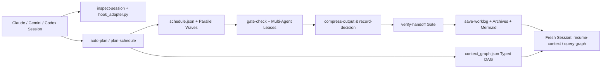

# context-budget-orchestrator

[](scripts/budget_engine.py)
[](scripts/budget_engine.py)
[](SKILL.md)
[](LICENSE)

A complete, zero-dependency, cross-CLI **Context Budget, Typed Context Graph & Multi-Agent Wave Orchestrator** built for **Claude Code**, **Gemini CLI**, and **OpenAI Codex CLI**.

## Why This Beats Built-In Compaction & Single-CLI Orchestrators

| Capability | Default CLI Compaction (Claude / Gemini / Codex) | `context-budget-orchestrator` v2.0 |
| --- | --- | --- |
| **Cutoff Strategy** | Emergency compaction near 90%+ after quality degrades | Proactive **68% safe ceiling** + **25,000-token floor** |
| **Provider Telemetry** | Opaque per-CLI internals | Extracts **exact** JSONL `usage` / `usageMetadata` tokens across all 3 CLIs + `tiktoken`/stdlib fallback |
| **Context-Rot & Thrash Detection** | None | Flags noisy tool outputs (>45%), repeated file edit thrashing, and repeated tool failures |
| **Handoff Memory Format** | Lossy linear prose summary | **Canonical Typed Context Graph** (`.agent_state/context_graph.json`) + slim Mermaid `WORKLOG.md` |
| **Cold-Start Resumption** | Re-reads whole summary & repo files | **Subgraph-pruned resume** (`--token-budget` cap) loads only upstream ancestors, ADRs, files & dead ends |
| **Task Decomposition** | Manual guessing | **`auto-plan`** static Python AST + JS/TS import-graph discovery + automatic oversized task splitting |
| **Multi-Agent Safety** | Parallel workers collide on files | File-disjoint **`parallel_waves`** + atomic TTL **`lease`** locks preventing edit conflicts |
| **Log Bloat Defense** | Raw logs blow out context | Deterministic **`compress-output`** slashes test/build/diff token burn by 70–95% |
| **Handoff Integrity** | Can stop mid-edit with syntax errors | **`verify-handoff`** checks Python AST syntax, JSON validity, merge markers & optional test command |
| **Native Hooks** | Vendor-specific | Cross-CLI **`scripts/hook_adapter.py`** ready for Claude Code `PreToolUse` & Gemini CLI `BeforeTool` |

## Architecture



## 1-Command Installation

```bash
git clone https://github.com/Aetherx86/context-budget-orchestrator.git
cd context-budget-orchestrator
bash install.sh
```

Wires the skill automatically into:
- **Claude Code:** `~/.claude/skills/context-budget-orchestrator`
- **Gemini CLI:** `~/.gemini/skills/context-budget-orchestrator`
- **OpenAI Codex CLI:** `~/.agents/skills/context-budget-orchestrator`

### Installer Flags
```bash
bash install.sh --doctor      # Verify Python 3.9+, optional tiktoken, all 3 CLI paths, and run full test suite
bash install.sh --copy        # Copy files instead of symlinking (for symlink-restricted environments)
bash install.sh --uninstall   # Cleanly remove all symlinks and installed files
```

## Complete CLI Subcommand Reference (12 Subcommands)

Every subcommand runs on Python 3.9+ stdlib alone and supports `--json`:

| Subcommand | What It Does |
| --- | --- |
| `inspect-session` | Extracts exact provider usage from Claude/Gemini/Codex JSONL transcripts, computes role/tool breakdown, detects context rot & edit thrashing, and classifies `GREEN` / `YELLOW` / `CRITICAL_HANDOFF`. |
| `auto-plan` | Scans local Python (`ast`) and JS/TS imports to build a real dependency DAG, token-safe batches, and file-disjoint parallel waves in one command. |
| `plan-schedule` | Validates manual task DAGs (missing deps + cycles), measures real file tokens, auto-splits oversized tasks (`__part1`, `__part2`), computes batches & parallel waves, and writes `schedule.json` + `context_graph.json`. |
| `gate-check` | Pre-task gate verifying projected usage stays under 68% ceiling, leaves >= 25,000 tokens, and has zero active multi-agent file-lease conflicts. |
| `lease` | Atomic TTL task & file-conflict lock manager (`--action claim|complete|release|status`) for safe multi-agent parallel swarms. |
| `record-decision` | Persists immutable Architectural Decision Records (`ADR-01`, rationale, related tasks/files) directly into `context_graph.json`. |
| `compress-output` | Pipes verbose test/build/diff logs through a deterministic compressor preserving failures, tracebacks, and `file:line` anchors. |
| `verify-handoff` | Pre-handoff gate checking modified `.py` syntax (`ast.parse`), `.json` validity, merge conflict markers, and optional `--verify-cmd`. |
| `save-worklog` | Captures git anchor, preserves immutable objective & constraints, updates `context_graph.json`, renders `WORKLOG.md` with Mermaid DAG, and archives timestamped snapshots. |
| `query-graph` | Extracts a priority-pruned subgraph (`--task-id`, `--depth`, `--token-budget`, `--mermaid`, `--dot`) reporting exact token savings vs. full history. |
| `resume-context` | Cold-start bootstrap returning `focused_subgraph`, recorded decisions, active leases, git drift detection, next batch tasks, and `resume_pointer`. |
| `status` | One-screen terminal mission-control dashboard showing budget bar, progress, graph counts, active leases, and next task. |

## Additional Documentation
- [SKILL.md](SKILL.md) — Agent operating contract discovered automatically by Claude Code, Gemini CLI, and Codex CLI
- [references/ARCHITECTURE.md](references/ARCHITECTURE.md) — Context Graph schema v2, priority pruning, and wave math
- [references/HOOKS.md](references/HOOKS.md) — Copy-paste hook setup for Claude Code `settings.json`, Gemini CLI `settings.json`, and Codex `AGENTS.md`
- [references/PROMPT_RECIPES.md](references/PROMPT_RECIPES.md) — Ready-to-use prompts for refactors, parallel swarms, and cold resumes

## License

[MIT](LICENSE)
