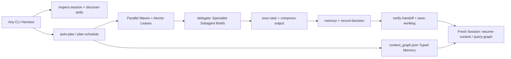

<p align="center">
  <strong>English</strong> | <a href="README.ko.md">한국어</a> | <a href="README.zh.md">中文</a> | <a href="README.es.md">Español</a>
</p>

# context-budget-orchestrator

[](scripts/budget_engine.py)
[](scripts/budget_engine.py)
[](references/HOOKS.md)
[](LICENSE)

A **zero-dependency, zero-bloat, universal AI Orchestrator Skill** built to handle complex software engineering and research projects lasting **minutes to hours** across **Claude Code, Gemini CLI, OpenAI Codex CLI, GitHub Copilot CLI, OpenClaw, OpenCode, DeepSeek Harness (`dsh`), and xAI Grok CLI**.

## Six Pillars — Zero Bloat

Most GitHub orchestrator skills either bloat your system prompt with 600+ lines of prose or only solve one narrow problem. `context-budget-orchestrator` keeps `SKILL.md` razor-lean (~100 lines) while backing it with a single Python 3.9+ stdlib engine covering every stage of autonomous work:

1. **Research & Organize Information (`memory`)** — Store structured research notes, sources, tags, architectural decisions (`record-decision`), and dead ends inside a canonical typed graph (`.agent_state/context_graph.json`) linked to tasks and files.
2. **Write & Execute Verified Code (`exec-task` + `compress-output`)** — Execute builds and tests with automatic 70–95% noisy-log compression and graph execution receipts so verbose stack traces never rot the context window.
3. **Delegate to Specialized Subagents (`delegate` + `lease`)** — Generate token-budgeted briefs for `researcher`, `architect`, `implementer`, `reviewer`, and `verifier` roles with atomic TTL file-conflict locks and ready-to-run dispatch commands across all 8 harnesses.
4. **Long-Horizon Graph Memory (`context_graph.json` + `query-graph` + `resume-context`)** — Traverse upstream dependencies to load **only the pruned relevant subgraph** (under an optional `--token-budget` cap) plus git drift detection and epoch counters across hours-long multi-session work.
5. **Work with Extensive Skill Libraries (`discover-skills`)** — Scan all installed CLI skill directories using **YAML frontmatter metadata only** to route to the exact 1–2 needed companion skills without loading 40 full skill files into context.
6. **Proactive Context-Budget Safety (`inspect-session` + `auto-plan` + `gate-check` + `verify-handoff`)** — Extracts exact provider `usage` tokens from JSONL transcripts, flags edit thrash loops & tool bloat, auto-discovers Python/JS/TS import DAGs into file-disjoint `parallel_waves`, enforces a **68% safe ceiling**, and verifies AST syntax/tests before any handoff.
7. **Built-In Security & Bug Audit Engine (`audit`)** — Zero-dependency static scanner across 14 CWE vulnerability/bug classes (SQLi, Command Injection, Unsafe Deserialization, Hardcoded Secrets, Weak JWT, SSRF, Path Traversal, XSS, Weak Crypto, Prototype Pollution, CORS, etc.) with authorized scope guards (`init-scope`), a 7-Question Triage Gate (`triage`), automatic secret/PII evidence redaction (`redact`), and 1-flag remediation task scheduling (`--create-tasks`).

## Supported Harnesses & Models

| Harness | Global Skill Path (wired by `install.sh`) | Native Telemetry / Dispatch |
| --- | --- | --- |
| **Claude Code** | `~/.claude/skills/context-budget-orchestrator` | Exact JSONL `usage`, `PreToolUse` hook, `claude -p` |
| **Gemini CLI** | `~/.gemini/skills/context-budget-orchestrator` | `usageMetadata`, `BeforeTool` hook, `gemini -p` |
| **OpenAI Codex CLI** | `~/.agents/skills/context-budget-orchestrator` | `total_tokens`, `AGENTS.md`, `codex exec` |
| **GitHub Copilot CLI** | `~/.copilot/skills/context-budget-orchestrator` | `/skills reload`, `.github/skills/`, `gh copilot -p` |
| **OpenCode** | `~/.config/opencode/skills/context-budget-orchestrator` | Provider-prefixed models (`provider/model`), `opencode run` |
| **OpenClaw** | `~/.openclaw/skills/context-budget-orchestrator` | `~/.openclaw/sessions`, `openclaw agent run` |
| **DeepSeek Harness (`dsh`)** | `~/.agents/skills/context-budget-orchestrator` | `deepseek-v4` (1M), `v3`/`r1`, `DEEPSEEK_SESSION`, `dsh run` |
| **xAI Grok CLI** | `~/.agents/skills/context-budget-orchestrator` | `grok-4` (256K), `grok-code-fast`, `GROK_SESSION`, `grok -p` |
| **Hermes Agent & Antigravity** | `~/.hermes/skills/` · `~/.gemini/config/skills/` | Auto-wired by both `install.sh` and Windows `install.ps1` |

## 1-Command Installation

```bash
git clone https://github.com/Aetherx86/context-budget-orchestrator.git
cd context-budget-orchestrator

# macOS / Linux
bash install.sh

# Windows (PowerShell)
pwsh ./install.ps1
```

### Installer Options
```bash
bash install.sh --doctor          # Verify Python 3.9+, optional tiktoken, all 6 harness paths & full test suite
bash install.sh --project .       # Install directly into ./.agents/skills/ and ./.github/skills/ for team repos
bash install.sh --copy            # Copy instead of symlinking (for symlink-restricted environments)
bash install.sh --uninstall       # Cleanly remove all global links and installed files
```

## Architecture



## CLI Subcommands (`scripts/budget_engine.py` — all support `--json`)

`inspect-session` · `discover-skills` · `auto-plan` · `plan-schedule` · `gate-check` · `lease` · `delegate` · `memory` · `record-decision` · `exec-task` · `compress-output` · `audit` · `verify-handoff` · `save-worklog` · `query-graph` · `resume-context` · `status`

## Additional Docs
- [SKILL.md](SKILL.md) · [references/ARCHITECTURE.md](references/ARCHITECTURE.md) · [references/HOOKS.md](references/HOOKS.md) · [references/SECURITY_AUDIT.md](references/SECURITY_AUDIT.md) · [references/PROMPT_RECIPES.md](references/PROMPT_RECIPES.md)

## License

[MIT](LICENSE)
